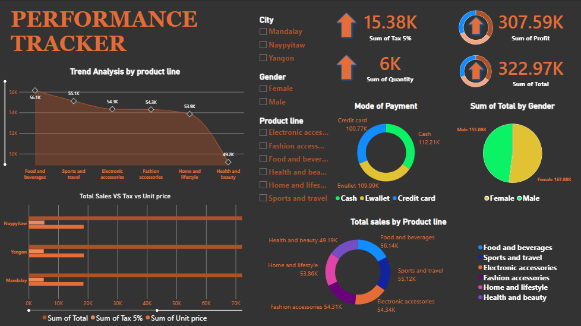

# Supermarket Sales Performance Tracker — Power BI Dashboard

A single-page Power BI performance tracker for a supermarket chain with three city branches. Built on 1,000 invoices (Jan–Mar 2019) to monitor revenue, tax and quantity sold, and to break sales down by product line, city, gender and payment method with interactive slicers.

🔗 **Live dashboard:** [View on NovyPro](NOVYPRO_LINK_HERE)
📥 **Open locally:** download [`Dashboard/Dashboard_1.pbix`](Dashboard/Dashboard_1.pbix) and open it in Power BI Desktop (free).



---

## Problem statement

A supermarket chain operating in Yangon, Mandalay and Naypyitaw wants one page that answers:

1. What are the headline numbers — total sales, tax collected, quantity sold and gross income?
2. Which product lines bring in the most revenue, and how wide is the gap between best and worst?
3. How do the three city branches compare on sales, tax and pricing?
4. Which payment methods do customers prefer?
5. Do male and female customers spend differently?
6. Can a manager filter the whole page to a single city, gender or product line?

## Key findings

- **Total sales 322.97K** across 1,000 invoices; **tax 15.38K** (5% by construction); **5,510 units sold**.
- **Revenue is evenly spread across product lines.** Food & beverages leads (56.1K) and Health & beauty trails (49.2K) — only a 7K gap across six lines.
- **The three branches are nearly identical.** Naypyitaw 110.6K, Yangon 106.2K, Mandalay 106.2K. No branch is under-performing.
- **No dominant payment method.** Cash 112.2K, Ewallet 110.0K, Credit card 100.8K.
- **Female customers spend more.** 167.9K vs 155.1K for males, despite an almost 50/50 invoice split (501 vs 499) — a higher average basket per visit.

## Dashboard components

| # | Visual | Question it answers | Visual type | Fields used |
|---|--------|---------------------|-------------|-------------|
| 1 | KPI cards | Headline totals | Card / KPI visuals | `SUM(Total)`, `SUM(Tax 5%)`, `SUM(Quantity)`, `SUM(gross income)` |
| 2 | Trend Analysis by product line | Revenue by product line, best vs worst | Area chart (sorted) | `Product line` (axis), `SUM(Total)` (values) |
| 3 | Total Sales vs Tax vs Unit price | Branch comparison on three measures | Clustered bar chart | `City` (axis), `SUM(Total)`, `SUM(Tax 5%)`, `SUM(Unit price)` |
| 4 | Mode of Payment | Payment-method preference | Donut chart | `Payment` (legend), `SUM(Total)` (values) |
| 5 | Sum of Total by Gender | Spend by gender | Pie chart | `Gender` (legend), `SUM(Total)` (values) |
| 6 | Total sales by Product line | Share of revenue per product line | Donut chart | `Product line` (legend), `SUM(Total)` (values) |
| 7 | Slicers | Filter the page by segment | Slicer visuals | `City`, `Gender`, `Product line` |

A per-visual explanation (why each visual type was chosen and what it shows) is in [`docs/analysis.md`](docs/analysis.md).

## Skills demonstrated

- Loading and profiling a CSV in Power Query
- Card and KPI visuals with implicit `SUM` measures and display units
- Sorted area chart and clustered bar chart for category comparison
- Pie and donut charts for part-to-whole breakdowns
- Slicers with cross-filtering across every visual on the page
- Dark-theme dashboard layout with a consistent colour palette

## Limitations

- `Tax 5%` and `gross income` are both exactly 5% of `Total` in this dataset, so they always track revenue and add no independent information.
- Three months of data (Jan–Mar 2019) is too short for seasonality; a date-based trend was not included for that reason.
- The area chart and the product-line donut show the same measure. A planned revision replaces the donut with average `Rating` by product line or sales by `Customer type` (Member vs Normal).

## Learning notes

This is a learning project built while studying Power BI. The starting point was a tutorial dashboard; I rebuilt it, checked each visual's figures against the source data, corrected a mislabelled card (it was summing `cogs` but labelled as profit), and documented the findings and limitations above. It is not intended to represent original research.

## Repository structure

```
Supermarket-Sales-PowerBI-Dashboard/
├── README.md
├── Dashboard/
│   └── Dashboard_1.pbix              # Power BI report file
├── Data/
│   └── supermarket_sales.csv         # source dataset (1,000 rows, 17 columns)
├── docs/
│   └── analysis.md                   # per-visual problem statements and explanations
└── images/
    └── dashboard.png                 # dashboard screenshot
```

## Data source

Supermarket Sales dataset (Kaggle, by Aung Pyae), 1,000 invoices from three branches in Myanmar, January–March 2019. Used for educational purposes.

## Tools

Power BI Desktop
